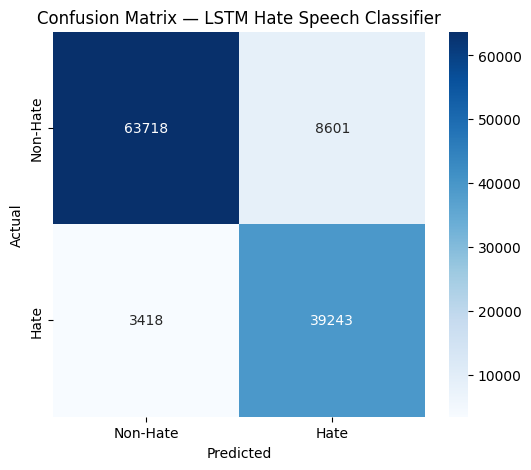

# AI-Powered Hate Speech Detection for Discord Moderation

Bidirectional LSTM classifier for detecting hate speech, trained on a BERT-augmented dataset and designed for integration into a Discord moderation bot.

BSCS Final Year Project, Govt Graduate College Pasrur (Punjab University).

## Overview
Online communities need automated moderation. This project builds a hate speech classifier and packages it for use in a Discord bot. The focus is on a more reliable training pipeline than simple duplication-based balancing.

## Pipeline
1. **Cleaning:** repaired a malformed CSV (unescaped commas), removed stray headers, resulting in 440,899 clean rows.
2. **Augmentation:** generated 134,000 synthetic hate rows with BERT contextual insertion (`nlpaug`), moving class balance from ~82/18 to ~63/37.
3. **Training:** 2-layer BiLSTM (PyTorch) with class-weighted loss, stratified 72/8/20 split, best checkpoint by validation hate-class F1.

## Results (test set, n = 114,980)

| Metric | Previous baseline | This work |
|---|---|---|
| Accuracy | 86.62% | **89.55%** |
| Hate-class F1 | 0.7920 | **0.8672** |
| Hate-class precision | - | 0.8202 |
| Hate-class recall | - | 0.9199 |



## Key Design Decisions
- **`insert` instead of `substitute` augmentation:** substitution replaced slurs and target-group words, corrupting labels. Insertion preserves the original keywords. Verified with three manual 30-sample reviews.
- **60/40 target instead of 50/50:** forcing 50/50 needs ~4x duplication of hate rows, risking memorization. Remaining imbalance handled with class weights.
- **Recall-favoring:** for moderation, missing hate speech is worse than over-flagging, since false positives can be reviewed.
- **Plain `bert-base-uncased`:** toxic-domain checkpoints produced garbled `[UNK]` insertions.

## Limitations
- Borderline phrasing can be misclassified (e.g. "that movie was so bad it should be illegal" was flagged at 0.556 confidence).
- ~3% of augmented rows have negation insertions that shift tone.
- English only; word-level tokenizer; no context beyond a single message.

## Installation
```bash
git clone https://github.com/RANDOMHSIS/hate-speech-detection.git
cd hate-speech-detection
pip install -r requirements.txt
```

## Usage
```python
from src.hate_speech_inference import HateSpeechDetector

d = HateSpeechDetector(
    "models/best_lstm_model.pt",
    "models/vocab.json",
    "models/model_config.json",
)
label, conf = d.predict("some text")
print(label, conf)  # e.g. NON-HATE 0.79
```

## Repository Structure
```
notebooks/   cleaning, augmentation, training
src/         inference module
models/      weights, vocab, config
results/     confusion matrix
data/        dataset info (CSVs not included)
```

## Data
See [`data/README.md`](data/README.md). Source: HateSpeechDataset.csv. Full CSVs are not stored in this repo due to size.


## License
MIT
